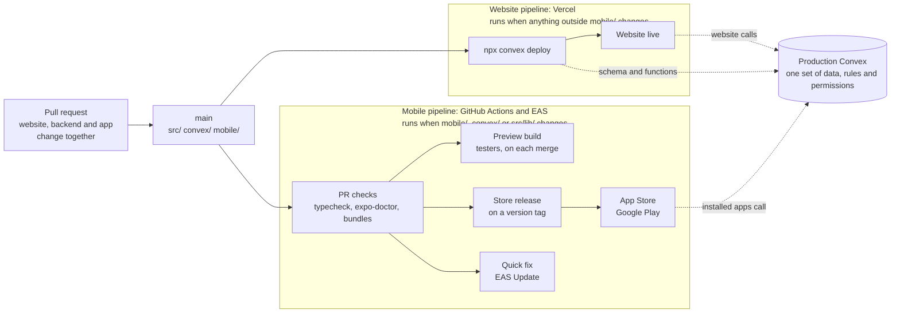

# Mobile release flow

How the website and the Sync Estate mobile app ship from one repository. The app
lives in `mobile/` on `main`, shares the Convex backend in `convex/` with the
website, and has its own pipeline.

## What happens when `feat/mobile-app` is merged

1. **Vercel builds `main`, as it does today.** Its build command
   (`vercel.json`) runs `npx convex deploy`, then builds the website.
2. **Production Convex gets three backend changes from the branch.** All are
   additions; nothing existing changes shape.
   - `expoPushTokens` table (starts empty), and phone push added to
     `convex/pushSender.ts` alongside browser Web Push.
   - `logs.recordLogin` fixed: it used a dynamic import Convex rejects, so
     sign-ins were never written to the audit log. They now are, on the
     website too.
   - `src/app/api/chat/route.ts` accepts `Authorization: Bearer <token>` as
     well as the Convex Auth cookie, so the app can use Copilot.
3. **The website redeploys with no visible change.** `mobile/` is excluded
   from the website's `tsconfig.json`, ESLint and Next.js build.
4. **The app is not built or shipped.** Until the mobile pipeline below
   exists, the code waits in `mobile/`. It can still be run on a phone with
   Expo Go (see `mobile/README.md`).

## Target setup

| Pipeline | Runs when | Does |
|---|---|---|
| Website (Vercel) | anything outside `mobile/` changes | deploys Convex, builds and serves the website |
| Mobile checks (GitHub Actions) | a pull request touches `mobile/`, `convex/` or `src/lib/` | `npx tsc --noEmit`, `npx expo-doctor`, iOS and Android bundle builds |
| Mobile preview (EAS Build) | a merge to `main` touches the same paths | internal build for testers |
| Mobile release (EAS Build and Submit) | a version tag such as `mobile-v1.2.0` | store build, submitted to the App Store and Google Play |
| Mobile quick fix (EAS Update) | a JavaScript-only fix | over-the-air update to installed builds with the same runtime version |

`mobile/`, `convex/` and `src/lib/` trigger the mobile pipeline because the
app calls the Convex functions directly and imports pure helpers from
`src/lib/` through the `@/` alias.

## Rules

- **Keep Convex backward compatible.** Released app versions stay on phones
  for months. Add functions and optional arguments; never rename or remove a
  function, argument or return field a released app uses. Retire one only
  when no supported app version calls it.
- **Filter each pipeline by path.** An app-only change must not redeploy the
  website, and a website-only change must not rebuild the app.
- **Tie quick fixes to a runtime version.** Set `runtimeVersion` from the app
  version (`"policy": "appVersion"` in `app.json`) so an EAS Update never
  reaches a build it was not made for. Anything that adds a native module or
  changes `app.json` plugins needs a new store build, not an update.
- **Use short branches off `main` for mobile work**, reviewed like website
  work. No long-lived mobile branch.

## To finish the setup

| Item | Owner | Notes |
|---|---|---|
| Merge `feat/mobile-app` into `main` | team | review the three backend changes above |
| Mobile checks workflow | engineering | `.github/workflows/mobile.yml` with path filters |
| EAS build profiles and update channels | engineering | `development`, `preview`, `production` in `mobile/eas.json` |
| Vercel ignored build step | engineering | skip the website build when only `mobile/` changed, e.g. `git diff --quiet HEAD^ HEAD -- . ':(exclude)mobile'` |
| Expo project | account owner | `eas init` in `mobile/` writes the project id into `app.json`; push needs it |
| Apple Developer and Google Play console | account owner | needed for store builds and submission |
| Production URLs | account owner | replace the `REPLACE-*` values in `mobile/eas.json` |
